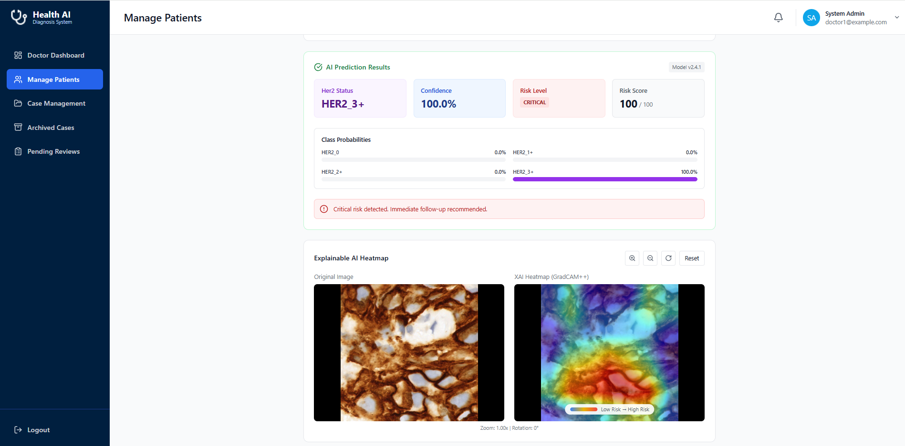
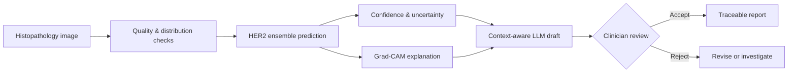
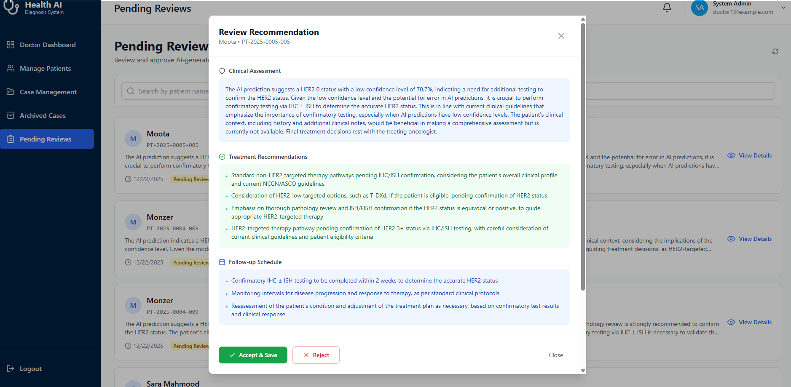
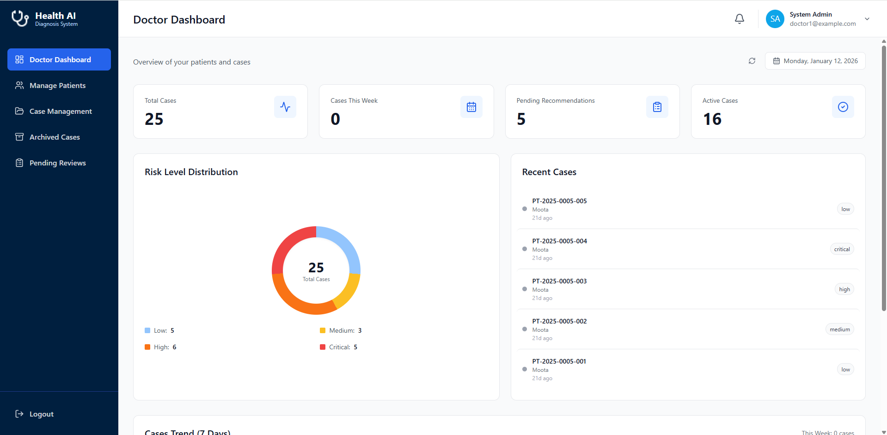
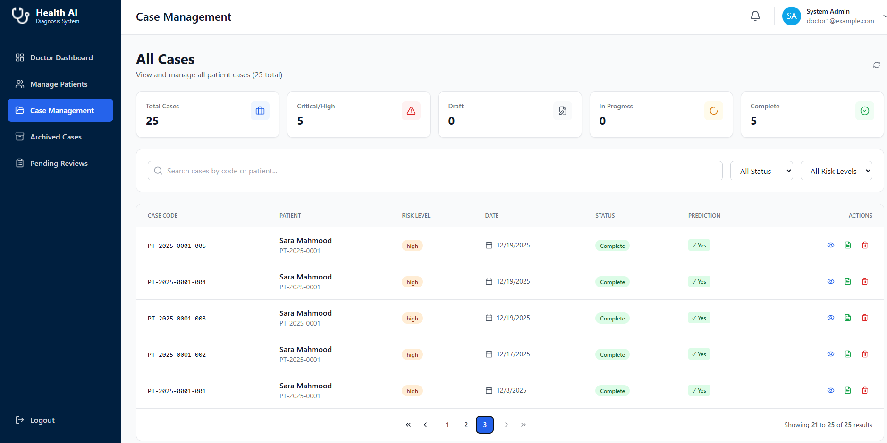

# Medx AI

### Explainable HER2 Decision Support With Clinician-Reviewed LLM Guidance

**Bakary Gibba · Md Rashidul Islam · Faisal Rafat Faisal Khrisan** 
Bachelor of Computer Science (Honours), Albukhary International University

> [!IMPORTANT]
> Medx AI is a research prototype for clinical decision support. It does not provide medical diagnoses or replace pathologists, oncologists, confirmatory testing, or institutional clinical protocols.

## The Project

Medx AI explores how an AI-assisted HER2 workflow can move beyond a standalone prediction model. The platform combines four-class histopathology classification, uncertainty-aware input checks, visual explanation, contextual LLM-generated recommendation drafts, and explicit clinician approval in one role-based web system.

| Reported model performance | Evaluation scope | Clinical roles | Public repository scope |
| :---: | :---: | :---: | :---: |
| ~96% weighted accuracy | 154 tests passed | Doctor · Nurse · Admin | Case study only |
| 4 HER2 classes | 4.5/5 average UAT | Separated responsibilities | No source or dataset |

## Why It Matters

HER2 assessment influences breast cancer treatment planning, but ambiguous staining, observer variability, resource constraints, and opaque AI predictions can limit confidence. Medx AI investigates a more responsible pattern:

The key design decision is the review boundary: model and LLM outputs remain assistive drafts, while clinicians retain final responsibility.

## Research Highlights

| Area | Portfolio evidence |
| --- | --- |
| Classification | Soft-voting ensemble across Random Forest, Logistic Regression, and SVM for HER2 `0`, `1+`, `2+`, and `3+` |
| Explainability | Grad-CAM overlays place visual evidence beside predictions instead of hiding interpretation in a separate research notebook |
| Safety | Blank-slide, blur, stain-profile, distribution-shift, and entropy checks can reject or defer uncertain inputs |
| Generative AI | Structured LLM drafts incorporate prediction context, optional notes, and extracted patient-history text |
| Human oversight | Recommendations follow draft, review, acceptance, rejection, and reporting states |
| System design | Role-based dashboards, audit history, object storage, model versioning, and traceable clinical records |

## Selected Experience

| Prediction & XAI | Clinician review |
| --- | --- |
|  |  |

| Role-based operations | Case lifecycle visibility |
| --- | --- |
|  |  |

[Browse all sanitized screenshots →](screenshots/README.md)

## Reported Evaluation

| HER2 class | Precision | Recall | F1 | Average precision |
| --- | ---: | ---: | ---: | ---: |
| `0` | 0.99 | 0.93 | 0.96 | 0.994 |
| `1+` | 0.87 | 0.96 | 0.92 | 0.950 |
| `2+` | 0.87 | 0.95 | 0.91 | 0.953 |
| `3+` | 1.00 | 0.98 | 0.99 | 0.999 |

> [!NOTE]
> These are project-report results from a controlled academic evaluation, not evidence of prospective clinical validity. External validation across institutions, scanners, demographics, and staining protocols remains necessary.

## My Contribution

Bakary Gibba's assigned responsibility was **model development and explainable AI**. The work included the image-processing and classification pipeline, ensemble design, class-imbalance strategy, prediction confidence and safety behavior, Grad-CAM integration, model evaluation, and contribution to documentation and system testing.

The project was collaborative: Md Rashidul Islam led frontend development, Faisal Rafat Faisal Khrisan led backend development, and all team members contributed to documentation and testing. See [My Contributions](docs/12-my-contributions.md) for the precise ownership boundary.

## Technology Landscape

| Layer | Technologies and patterns |
| --- | --- |
| AI and imaging | Python, scikit-learn, PyTorch, OpenCV, OpenSlide, Grad-CAM, entropy analysis |
| Generative AI | Groq-hosted Llama, Gemini fallback, structured prompting, OCR-assisted context |
| Application | React, TypeScript, Vite, Tailwind CSS, Django, Django REST Framework |
| Data and storage | PostgreSQL-oriented relational design, Django ORM, MinIO object storage |
| Security and governance | JWT, RBAC, 2FA-ready flows, audit logging, soft deletion, model registry |

## Case Study Navigation

| Research | Engineering | Responsible AI |
| --- | --- | --- |
| [Executive Summary](docs/01-executive-summary.md) | [System Architecture](docs/07-system-architecture.md) | [Safety & Ethics](docs/11-safety-and-ethics.md) |
| [Clinical Problem](docs/02-clinical-problem.md) | [Data & System Design](docs/08-data-and-system-design.md) | [Challenges](docs/13-challenges.md) |
| [Research Methodology](docs/03-research-methodology.md) | [Clinical Workflows](docs/09-clinical-workflows.md) | [Future Work](docs/14-future-work.md) |
| [AI Model](docs/04-ai-model.md) | [Evaluation](docs/10-evaluation.md) | [Appendix](docs/appendix.md) |
| [Explainable AI](docs/05-explainable-ai.md) | [My Contributions](docs/12-my-contributions.md) | [Diagram Library](diagrams/README.md) |
| [LLM Recommendations](docs/06-llm-recommendations.md) | [Screenshot Gallery](screenshots/README.md) | [Documentation Index](docs/README.md) |

## Lessons Learned

- Accuracy alone is insufficient in high-stakes AI; uncertainty, explanation, traceability, and escalation must shape the workflow.
- Clinician review is a system state and accountability boundary, not a disclaimer added after generation.
- Data-efficient models can be valuable when compute and labeled medical data are limited, but external validity matters more than a single benchmark.
- LLMs are better positioned as structured communication and decision-support layers than autonomous clinical authorities.

---

**Public academic case study · January 2026**

[GitHub Profile](https://github.com/BakaryGibba) · [Portfolio](https://bakary-gibba.vercel.app/) · [LinkedIn](https://www.linkedin.com/in/bakary-gibba-6409bb248/)

This repository intentionally excludes source code, model weights, credentials, the private project report, patient records, and the underlying research dataset.

