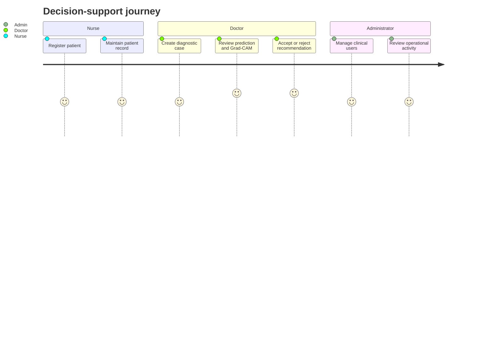

# 02 · Clinical Problem

[← Back to README](../README.md) · [Documentation index](README.md)

## Context

HER2 status is a clinically important biomarker in breast cancer management. Immunohistochemistry scoring commonly distinguishes four categories: `0`, `1+`, `2+`, and `3+`. Intermediate cases can be difficult to interpret and may require confirmatory testing.

## Problem Framing

The project identified four connected gaps:

| Gap | Why it matters |
| --- | --- |
| Observer variability | Visual scoring can differ across reviewers, particularly for ambiguous staining patterns |
| Opaque AI | A prediction without interpretable evidence is difficult to challenge or trust |
| Isolated research models | A notebook metric does not provide identity, case, storage, review, or audit workflows |
| Generic recommendations | Raw class probabilities do not translate directly into safe, contextual clinical communication |

## Design Question

How might a resource-conscious system combine HER2 classification, explainability, uncertainty handling, and personalized recommendation drafts while preserving clinician authority?

## Stakeholders

## Non-Goals

Medx AI is not an autonomous diagnosis service, treatment prescriber, replacement for pathology review, substitute for confirmatory IHC/ISH/FISH testing, or production-certified medical device.
