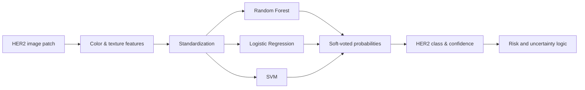

# 04 · AI Model

[← Back to README](../README.md) · [Documentation index](README.md)

## Modeling Choice

The classification pipeline used engineered color and texture features with a soft-voting ensemble of Random Forest, Logistic Regression, and Support Vector Machine classifiers.

This choice prioritized data efficiency, faster inference, and deployability under limited compute. The trade-off is reduced automatic representation learning compared with large convolutional models.

## Feature and Training Pipeline

| Stage | Purpose |
| --- | --- |
| Color statistics | Represent staining intensity patterns across RGB channels |
| Texture gradients | Capture basic morphology and local variation |
| Standardization | Place heterogeneous features on comparable scales |
| Oversampling | Reduce bias toward dominant HER2 classes |
| Soft voting | Combine complementary decision boundaries and probability estimates |
| Serialization | Support lightweight deployment and versioned inference |

## Safety Wrapper

Before inference, the research prototype checks whether an image is sufficiently tissue-rich, focused, stained, and similar to the expected training distribution. After inference, entropy is used to identify uncertain outputs that should be deferred for manual review.

| Check | Research intent |
| --- | --- |
| Blank-region ratio | Reject insufficient tissue content |
| Laplacian variance | Detect likely blur |
| Stain coverage | Reject images without expected histology signal |
| Histogram similarity | Flag likely out-of-distribution inputs |
| Predictive entropy | Avoid forcing a confident-looking class from diffuse probabilities |

> [!NOTE]
> Thresholds described in the academic report are prototype heuristics. They require external calibration before use across scanners, laboratories, or staining protocols.

The report describes Grad-CAM generation through a surrogate ResNet18 model rather than the classical soft-voting classifier itself. The heatmap therefore provides auxiliary spatial evidence; it should not be interpreted as a faithful attribution of the ensemble's exact decision process.

## Trade-Off

The ensemble offered a practical bridge from research to application, but its handcrafted features can encode assumptions that fail under domain shift. A production study would compare this approach against calibrated deep models under cross-site validation and require explanation methods aligned directly with the deployed predictor.
