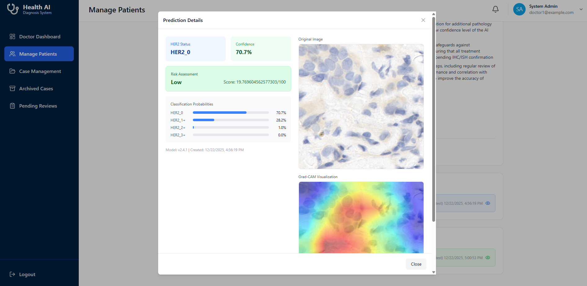
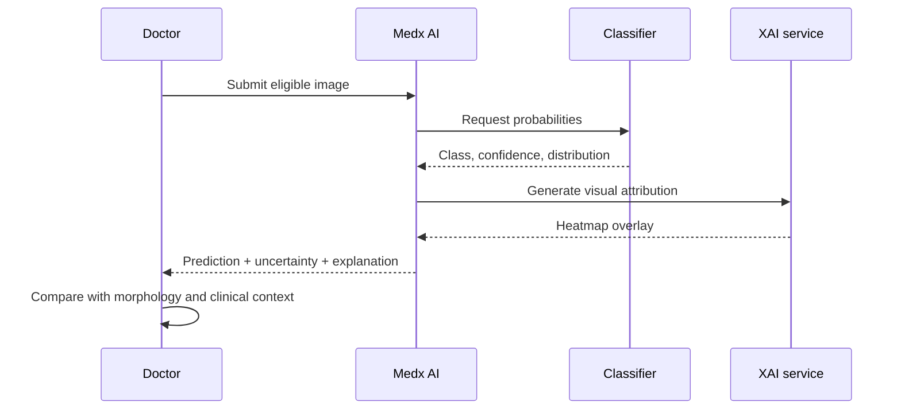

# 05 · Explainable AI

[← Back to README](../README.md) · [Documentation index](README.md)

## Purpose

Medx AI treats explanation as part of the review workflow. A prediction is displayed beside confidence, class probabilities, risk interpretation, the original image, and a Grad-CAM heatmap so a clinician can question whether the highlighted region is plausible.

## Explanation Workflow

## Design Decisions

- Show the original and explanation together.
- Preserve the full probability distribution rather than only the winning class.
- Route uncertainty into review behavior.
- Record the model version associated with the prediction.
- Avoid presenting visual attention as causal proof.

## Important Limitation

Grad-CAM can show where a model focused, but not whether its reasoning is medically correct. Heatmaps can be unstable, visually persuasive, and sensitive to implementation choices. They support scrutiny; they do not validate a diagnosis.

> [!CAUTION]
> The documented classifier is a classical soft-voting ensemble, while the report describes Grad-CAM through a surrogate ResNet18. Because the explanation model and prediction model are not identical, the heatmap is an auxiliary visualization rather than a direct, faithful explanation of the ensemble output. Future work should either align the explainer with the deployed model or formally validate surrogate fidelity.

## Bakary's Ownership

Model development and XAI were Bakary Gibba's assigned project responsibility. This included connecting classification behavior with visual attribution and uncertainty-aware presentation, then evaluating whether the resulting artifacts aligned with diagnostically meaningful regions in the documented test setting.
