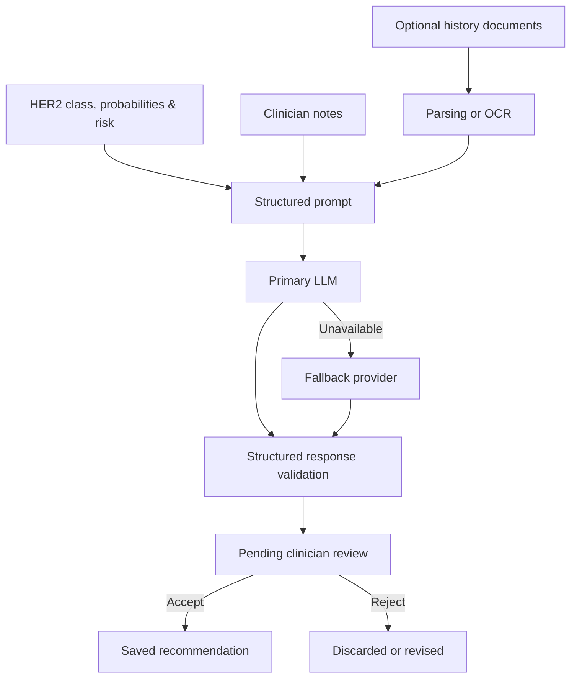

# 06 · LLM Recommendations

[← Back to README](../README.md) · [Documentation index](README.md)

## Role of the LLM

The LLM layer does not classify an image. It converts structured model outputs and optional clinical context into a reviewable recommendation draft with four sections: assessment, treatment considerations, follow-up, and risk mitigation.

## Context Pipeline

## Reliability Design

| Decision | Reason |
| --- | --- |
| Structured JSON response | Makes validation and report rendering more predictable |
| Conservative generation settings | Reduces unnecessary variation in high-stakes text |
| Primary and fallback provider | Improves availability without changing the review boundary |
| Safe parser fallback | Returns conservative guidance when generated structure is malformed |
| Explicit pending state | Prevents generated text from becoming a clinical record automatically |

## Personalization Inputs

The documented prototype can use prediction confidence, risk, class probabilities, clinician notes, and extracted patient-history text. Document text may come from digital PDFs, DOCX files, images, or scanned PDFs through parsing and OCR workflows.

## Risks

- Hallucinated or outdated medical guidance.
- Prompt injection or untrusted instructions in uploaded documents.
- Excessive confidence caused by polished language.
- Missing provenance for guideline statements.
- Privacy exposure through external model providers.

The clinician approval state is necessary but not sufficient. A deployable system would also require grounded guidelines, citation verification, privacy agreements, prompt-injection defenses, and formal clinical governance.
