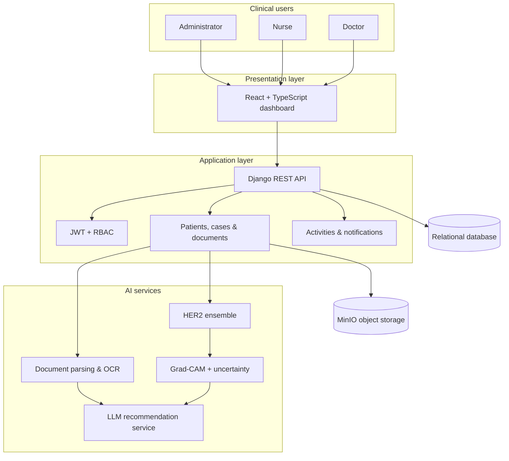

# 07 · System Architecture

[← Back to README](../README.md) · [Documentation index](README.md)

## Architectural View

Medx AI uses a layered web architecture. A React client presents role-specific workflows; Django REST Framework coordinates clinical records, AI services, documents, recommendations, and audit behavior; relational storage holds structured state; object storage holds larger medical artifacts.

## Module Boundaries

| Domain | Responsibility |
| --- | --- |
| Users | Identity, authentication, roles, archived accounts, security controls |
| Patients | Demographic and clinical profile management |
| Cases | Diagnostic episode lifecycle and ownership |
| Documents | Metadata, secure storage references, parsing, and OCR |
| AI | Prediction records, model execution, confidence, XAI artifacts |
| Recommendations | LLM generation and controlled review lifecycle |
| Activities | Traceable user and workflow events |
| Notifications | Operational and review alerts |
| Dashboard | Role-specific aggregate views |

## Key Trade-Offs

| Choice | Benefit | Cost |
| --- | --- | --- |
| Modular monolith | Clear ownership with straightforward deployment | AI workloads may later need independent scaling |
| REST application boundary | Familiar contracts and role enforcement | Long inference or OCR tasks need asynchronous execution at scale |
| Object storage for files | Keeps relational records compact and traceable | Requires signed access and lifecycle governance |
| External LLM/OCR providers | Faster experimentation and provider fallback | Introduces privacy, availability, and data-residency concerns |

See the editable [architecture diagram](../diagrams/architecture.mmd).
