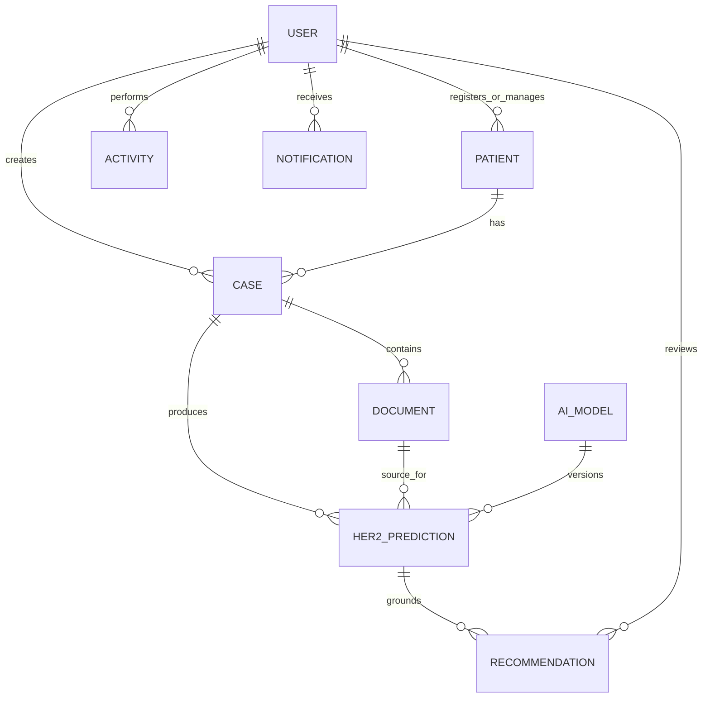

# 08 · Data & System Design

[← Back to README](../README.md) · [Documentation index](README.md)

## Data Philosophy

Structured clinical state belongs in the relational model; large image, document, and explanation artifacts belong in object storage. References connect the two so every prediction and recommendation can be traced to its case, source artifact, model, and responsible user.

## Core Records

| Entity | Why it exists |
| --- | --- |
| User | Identifies doctors, nurses, and administrators and enforces responsibility |
| Patient | Holds the patient context required by clinical workflows |
| Case | Acts as the container for one diagnostic episode |
| Document | References securely stored images and supporting history files |
| HER2 prediction | Persists class, confidence, probabilities, risk, XAI reference, and model version |
| Recommendation | Connects generated guidance to the exact prediction and reviewing clinician |
| Activity | Supports auditability across high-value actions |
| AI model | Separates model identity and version from individual predictions |

## Lifecycle Choices

- UUID-oriented identifiers reduce accidental information leakage through sequential IDs.
- Soft deletion preserves recoverability and audit context for clinical records.
- User archival separates account removal from historical traceability.
- Model-version references support reproducibility and post-hoc review.
- Approved recommendations are kept distinct from generated drafts.

## Public Repository Boundary

This case study does not publish schema migrations, raw records, storage keys, patient documents, database backups, model artifacts, or exact implementation details that could reveal protected system internals.
