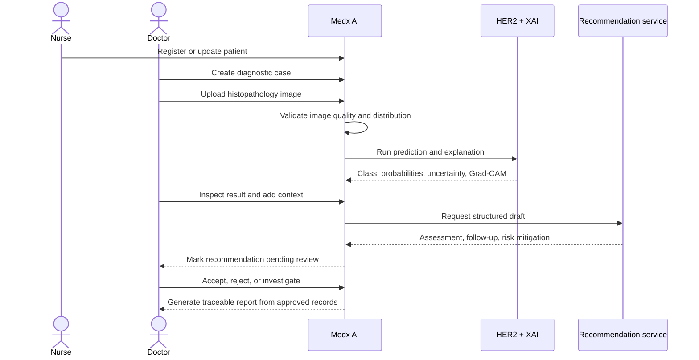
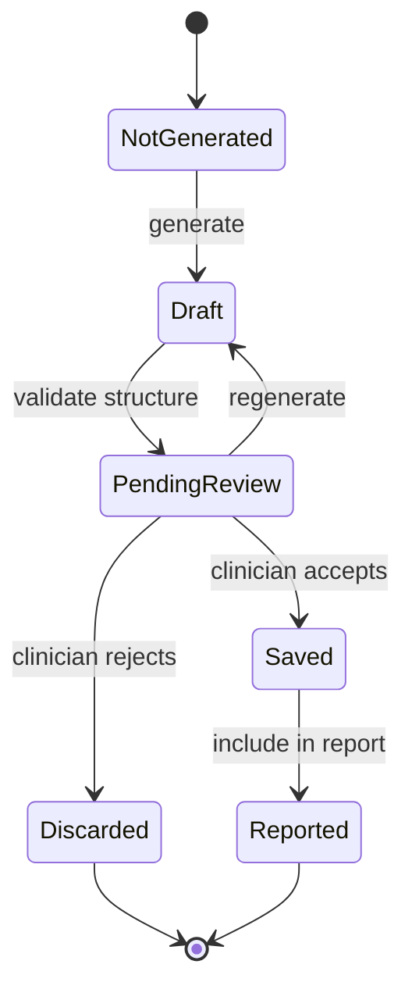

# 09 · Clinical Workflows

[← Back to README](../README.md) · [Documentation index](README.md)

## Role Separation

| Role | Primary responsibilities |
| --- | --- |
| Nurse | Register and maintain patient records |
| Doctor | Create cases, run analysis, inspect explanations, review recommendations, finalize reports |
| Administrator | Manage users, archives, platform activity, and operational visibility |

## Diagnostic Sequence

## Recommendation State

## UX Principle

The interface surfaces uncertainty, risk, explanation, and review actions in the same workflow. This reduces the chance that an AI output is mistaken for a finalized clinical decision simply because it appears polished or authoritative.

See the [workflow screenshots](../screenshots/README.md) for implemented evidence.
