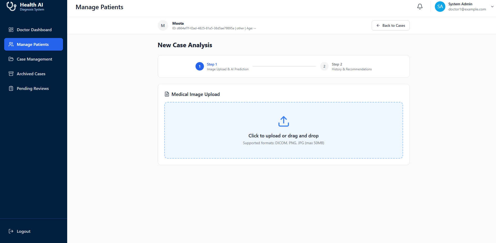
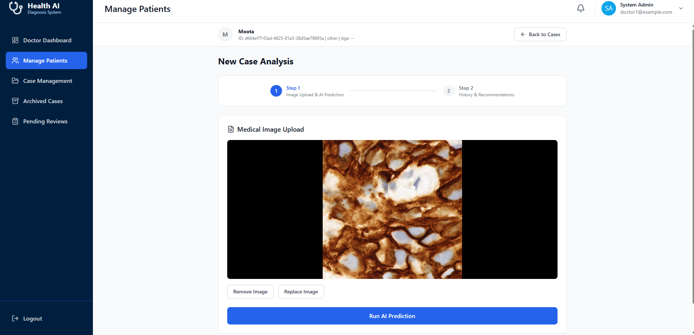
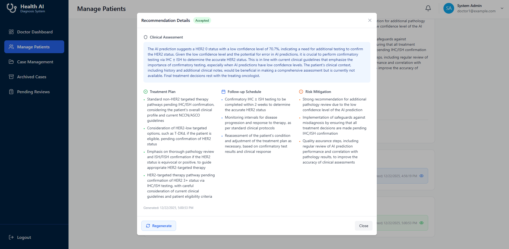
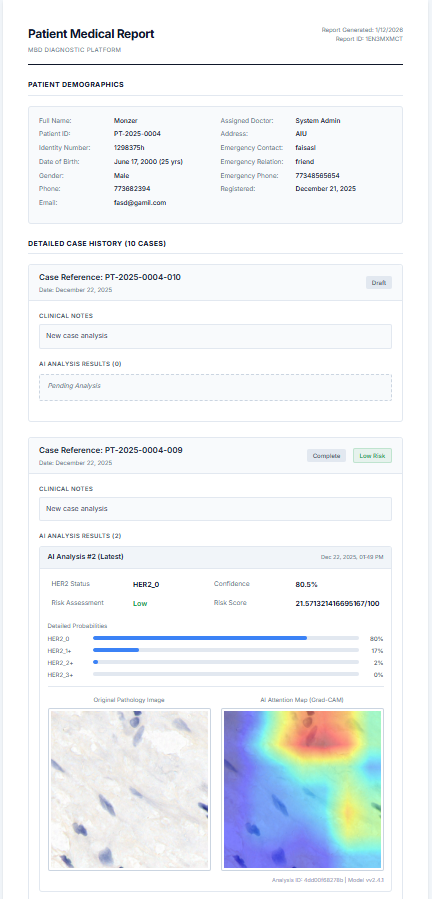

# Screenshot Gallery

[← Back to the Medx AI case study](../README.md)

These images document the implemented prototype using demonstration records. They are interface evidence, not a clinical dataset, and should not be interpreted as real-world medical validation.

> [!CAUTION]
> Several original captures display demonstration names, contact details, case identifiers, and pathology imagery. Confirm that all visible identities are fictional or consented before wider promotion. For conference slides or public presentations, use cropped or redacted copies.

## Core AI Workflow

| Screenshot | What it demonstrates |
| --- | --- |
|  | Step-based case flow before model inference |
|  | Histopathology image preview and explicit prediction action |
|  | Four-class output, confidence, risk, class probabilities, and XAI heatmap |
|  | Original image and Grad-CAM explanation shown together |
|  | Clinician acceptance or rejection boundary |
|  | Structured assessment, follow-up, and risk-mitigation sections |
|  | Traceable report artifact combining case and AI outputs |

## Role-Based Experience

| Screenshot | What it demonstrates |
| --- | --- |
| [Admin dashboard](admin-dashboard.png) | Platform operations, activity, users, and case volume |
| [User management](admin-user-management.png) | Doctor and nurse lifecycle management |
| [Doctor dashboard](doctor-dashboard.png) | Cases, risk distribution, and pending reviews |
| [Case management](case-management.png) | Searchable case workflow and status tracking |
| [Case history](case-history.png) | Longitudinal case and recommendation state |
| [Nurse dashboard](nurse-dashboard.png) | Registration-oriented workflow and patient overview |

## Supporting Captures

Additional available images: `archived-users.png`, `admin-profile.png`, `security-settings.png`, `doctor-patients.png`, `case-detail-prediction.png`, `doctor-profile.png`, `nurse-profile.png`, and `patient-details.png`.

`legacy-gallery.md` preserves the original GitHub-hosted image references for traceability. The case study uses local, meaningfully named assets so links remain portable.
